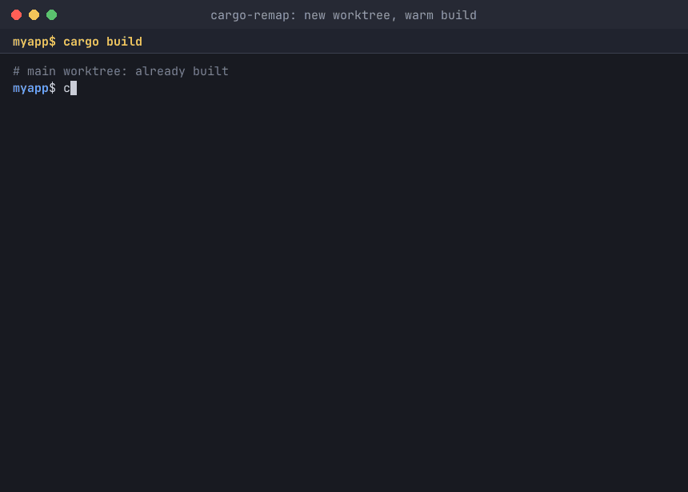

# cargo-remap

**A new git worktree that builds as fast as the one you copied it from.**



`cargo-remap` runs cargo (and any other command) with the current git worktree
bind-mounted at one fixed path, inside a private mount namespace, so every worktree
builds from the same absolute path. Together with `cargo remap worktree add`, which
seeds the new worktree with a copy on write copy of `target/`, a fresh worktree
starts with a warm build cache. Linux only, no root needed, nothing outside the
command is touched.

| in a new worktree | `git worktree add` | `cargo remap worktree add` |
|-------------------|-------------------:|---------------------------:|
| `cargo build`     |             6.81 s |                     0.05 s |
| `cargo check`     |             4.18 s |                     0.04 s |

Measured (as in the GIF) on a ~200-crate project (tokio, axum, reqwest, clap, serde)
on btrfs. Absolute times depend on your machine; the remap column stays near zero
however big the dependency tree is. Only files you changed get rebuilt.

## Why

Cargo's fingerprints and debug info contain absolute paths, and cargo compares source
mtimes. A plain `git worktree add` therefore starts with a cold `target/`, and even a
hand-copied `target/` still rebuilds your own crates. This hurts most when you keep
many worktrees: parallel feature branches, bisecting, reviews, or several coding agents
working side by side.

## Install

```text
cargo install --path .     # the source directory must be writable (cargo builds in its target/)
cargo-remap doctor         # run anywhere: checks everything needed, or says what to install
cargo-remap install        # recommended: plain `cargo` now goes through cargo-remap
```

`~/.cargo/bin` must be in `PATH` (rustup does this). Requires Linux, `git`, util-linux's
`unshare`, `setpriv` and `mount`, and unprivileged user namespaces. These are the default
on Debian, Fedora, Arch, openSUSE and Rocky; **Ubuntu 23.10 and later need a small AppArmor profile**,
and Alpine needs `apk add git util-linux-misc setpriv mount`. `doctor` and every failing
command say exactly what to run (see
[Requirements and troubleshooting](#requirements-and-troubleshooting)).

`install` links `cargo` into `~/.local/bin`. That directory must come **before**
`~/.cargo/bin` in `PATH`; if it does not, `install` prints the two lines to add. Check with
`command -v cargo` (it should print `~/.local/bin/cargo`), or run `cargo-remap doctor`. Shells that
do not read `~/.profile` (non-login shells, `ssh host command`) need the `PATH` set another way.
With the link in place, `cargo` outside a git repository (`cargo new`, `cargo install`, ...)
simply runs the real cargo.

`doctor` checks the directory it runs in (a bind mount of it, plus a copy on write probe), so
run it in your project for the most telling result.

Copy-on-write copies (btrfs, XFS with reflink; also overlayfs on top of those) make the
first build in a new worktree instant. Elsewhere `target/` is copied in full, which works
but takes longer and more space; `doctor` tells you which case you are in.

## Quick start

The repository needs at least one commit (commit `Cargo.lock` too, for applications), and
`target/` should be in `.gitignore`.

```text
cargo build                                      # warm up this worktree once
cargo remap worktree add ../feature -b feature   # same arguments as git worktree add
cd ../feature && cargo build                     # nothing to recompile
```

If you skipped `cargo-remap install`, run cargo as `cargo-remap cargo build`;
`cargo remap worktree add` works either way.

Every worktree is mapped onto the **main worktree's path**, so inside `../feature`,
`cargo remap exec pwd` prints the main worktree's path. That is the point: all worktrees
build from one absolute path and share fingerprints. The main worktree itself is
unchanged. Set `CARGO_REMAP_VERBOSE=1` to print the mapping on every run.

## Running cargo and other commands

```text
cargo-remap cargo build --release     # cargo, with the worktree mapped
cargo-remap exec <command> [args...]  # anything else; or: cargo remap exec ...
```

It runs a single `unshare --user --keep-caps --mount` with your uid/gid mapped to
themselves, bind-mounts the worktree, drops the namespace capabilities, and runs the
command. File ownership looks the same as on the host. `sudo` and setuid binaries
don't work inside, and root-owned files show as `nobody`.

`exec` runs the command in the same directory relative to the repo root, with the same
backend and environment as a cargo run: `exec pwd` prints the mapped path, and tools
that bake in absolute paths (debuggers, editors, linters, `make`, scripts) see the same
paths in every worktree.

## Config

`.cargo-remap.toml` in the repo (searched upward from cwd), else
`~/.config/cargo-remap/config.toml`, or the file named by `CARGO_REMAP_CONFIG`.

```toml
path = "/home/me/src/proj"          # default: the main worktree of the repo
target_dir = "~/.cache/proj-target" # optional: exported as CARGO_TARGET_DIR
cargo = "cargo"                     # optional
```

## Coding agents

```text
cargo-remap agents                          # print the guide
cargo-remap agents --install [--path FILE]  # install it into the current repo
```

The guide explains how to run commands (`cargo remap`, `cargo remap exec`), how to
create worktrees, and how to read paths in output. `--install` writes it as a skill
file, by default `.agents/skills/cargo-remap/SKILL.md`, and adds a short managed block
to `AGENTS.md` that points at it (creating the file if needed, replacing only the block
between the `cargo-remap:begin/end` markers on re-runs).

`--path` (or `agents_path` in `.cargo-remap.toml`) picks another location, relative to
the repo root; a directory gets `SKILL.md` appended. Use `--path
.claude/skills/cargo-remap/SKILL.md` if you want Claude Code to discover it as a skill.
Re-run `--install` after upgrading cargo-remap to refresh the file. Moving the file
leaves the old one behind; delete it yourself.

## Replacing `cargo`

```text
cargo-remap install [--dir DIR]     # default DIR: ~/.local/bin
cargo-remap uninstall [--dir DIR]   # without --dir: removes our links found in PATH
```

`install` symlinks `DIR/cargo` to cargo-remap. DIR must come before the real
cargo in PATH (it warns if not). Started as `cargo`, the wrapper finds the real cargo
by skipping itself in PATH (or uses the `cargo` config key), and forwards everything,
including `--help` and `+toolchain`. Its own commands are then reached as
`cargo remap <command>`. Programs run inside a remapped build (build scripts) get
`CARGO_REMAP_ACTIVE=1`, so a nested `cargo` goes straight to the real cargo.
Uninstall refuses to touch a `cargo` that isn't a cargo-remap link.

## Requirements and troubleshooting

cargo-remap needs unprivileged user namespaces and these programs: `git`, and util-linux's
`unshare`, `setpriv` and `mount`. Before every run it does a no-op run of the same
steps, and if that fails it stops and tells you what to do:

| what is wrong | what the message tells you |
|---|---|
| a program is missing (or only BusyBox's version is) | one list of every missing program, the package that has it, and the install command for apt, dnf, pacman, zypper and apk |
| Ubuntu 23.10+ (AppArmor blocks user namespaces) | a 6-line AppArmor profile that allows user namespaces for `unshare` only (other programs stay restricted), copy-pasteable, and how to undo it; the system-wide `sysctl` is mentioned only as the fallback for AppArmor older than 4.0 |
| user namespaces disabled in the kernel | the `sysctl` to enable them (`user.max_user_namespaces`, or `kernel.unprivileged_userns_clone` on some Debian kernels) |
| BusyBox `unshare`/`setpriv` (Alpine) | install util-linux |
| running inside a container that forbids namespaces | use rootless podman, which works with default settings (see [Containers](#containers)) |
| `cargo` not found | how to install Rust with rustup |

There is no container (podman/docker) fallback.

Outside a git repo `path` is required. If the current worktree already is the
target path, cargo runs directly.

`CARGO_REMAP_DRY_RUN=1` prints the command instead of running it.

## Worktrees

```text
cargo-remap worktree add ../feature -b feature   # same args as git worktree add
cargo-remap worktree list|remove|...             # passed through to git
```

`add` runs `git worktree add`, then seeds the new worktree from the current one
(`cp -a`, copy on write where the filesystem supports it, mtimes kept), and
finally copies the mtimes of all tracked files that are unchanged relative to the
source worktree, so cargo sees the copied `target/` as fresh. Files that differ, or
that are dirty in the source, keep their new mtime and get rebuilt.

```toml
[worktree]
copy_target = true        # copy target/ (skipped if `target_dir` is set)
copy_gitignored = true    # copy everything gitignored (except target/)
copy_files = [".env"]     # extra paths relative to the repo root
reflink = "auto"          # "auto": CoW if supported, else full copy; "always": CoW or skip; "never"
```

## Containers

**Use rootless podman.** It works with its default settings, as root or as a normal user inside
the container, and needs no flags for cargo-remap:

```text
podman run --rm -it -v "$PWD":/work -w /work IMAGE ...      # add :z to the -v on SELinux hosts
```

Tested with stock podman settings (no user `containers.conf`) on
Debian, Ubuntu 22.04 and 24.04, Fedora, Arch, openSUSE, Rocky and Alpine images, with cargo-remap
itself or, where its binary would not run, the same `unshare` and `mount` steps. Or run
cargo-remap outside the container. Docker's default seccomp and AppArmor profiles block the
namespace; this README does not cover loosening them.

## Tested on

`tests/distros/run.sh` runs the checks in rootless podman containers (install from
source with `cargo install`, `exec`, `worktree add`, warm builds, the `cargo` wrapper,
reflink modes, and the error messages); `tests/distros/vm-ubuntu.sh` boots a real
Ubuntu 24.04 VM to test AppArmor's restriction on user namespaces.

| distro | result |
|--------|--------|
| Debian stable, Fedora, Arch, openSUSE Tumbleweed, Rocky 9, Ubuntu 22.04 | works by default |
| Ubuntu 24.04 | one AppArmor profile needed (the error message prints it) |
| Alpine | works after `apk add util-linux` (busybox alone is not enough) |

Containers share the host kernel, so these runs cover distro userland, not kernel
policy; the Ubuntu 24.04 VM covers the AppArmor case.

## Caveats

- Mounting a linked worktree over the main worktree hides the main `.git`, so
  cargo-remap mounts the real git directory at a private path
  (`$TMPDIR/cargo-remap-<uid>/git`) and a replacement `.git` file over the worktree's.
  Git works inside the mapping, including in build scripts; only `git worktree list`
  there shows the main worktree at that private path.
- cargo still compares file mtimes, so a fresh checkout rebuilds workspace crates.

## Source layout

Everything is done by shelling out to `unshare`, `mount`, `setpriv` and `git`.
Run `cargo doc --document-private-items` to browse the modules:

- `cli`: turns the command line into an action
- `config`: the `.cargo-remap.toml` schema and its lookup
- `backend`: builds and checks the namespace command that maps the worktree
- `diagnose`: error messages for missing programs and blocked namespaces
- `worktree`: `worktree add`, target copying and mtime restoration
- `install`: the `cargo` symlink (`install` / `uninstall`)
- `agents`: the guide for coding agents
- `help`: the text of `--help`
- `util`: small helpers (`die`, `git`, path utilities)

## License

MIT, see [LICENSE](https://github.com/susitsm/cargo-remap/blob/main/LICENSE).
